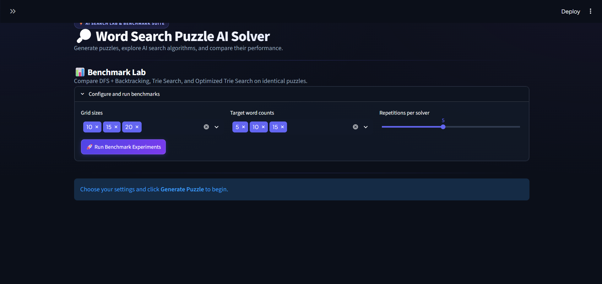
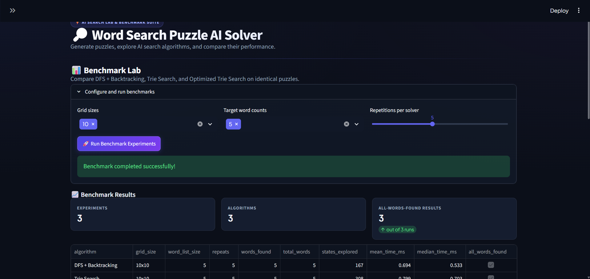
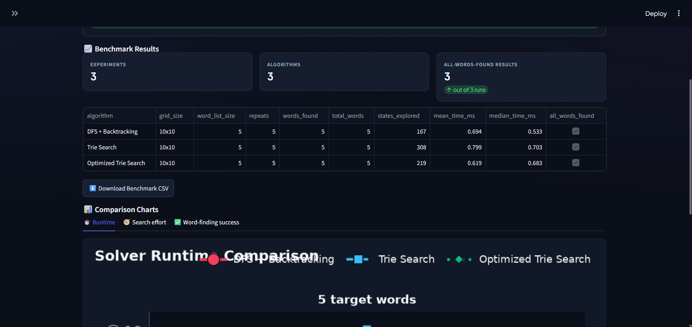
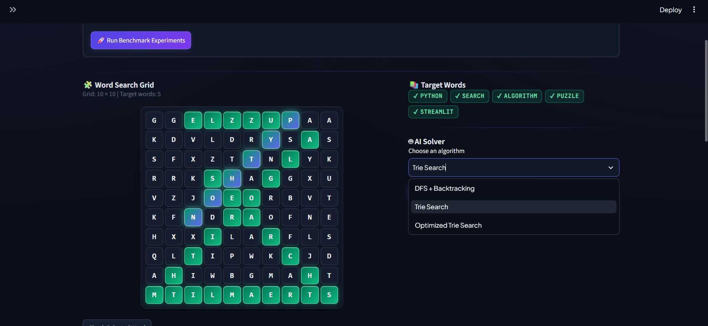

# Word Search Puzzle AI Solver

An interactive AI-based word-search application built with Python and
Streamlit. It implements and compares three search strategies: **DFS
with Backtracking, Trie Search, and Optimized Trie Search**.

Generate puzzles, solve them manually or with AI, visualize the search
process through recorded traces, and compare algorithm performance using
execution time, search effort, and word-finding results.

**Repository:**
[harshkdm31/word-search-puzzle-ai-solver](https://github.com/harshkdm31/word-search-puzzle-ai-solver)

## Contents

-   [Project Objectives](#1-project-objectives)
-   [Features](#2-features)
-   [Algorithms](#3-algorithms)
-   [Technology Stack](#4-technology-stack)
-   [Project Structure](#5-project-structure)
-   [Installation and Setup](#6-installation-and-setup)
-   [Using the Application](#7-using-the-application)
-   [Benchmarking and Evaluation](#8-benchmarking-and-evaluation)
-   [Running Tests](#9-running-tests)
-   [Screenshots](#10-screenshots)
-   [Design Scope and Limitations](#11-design-scope-and-limitations)
-   [Conclusion](#12-conclusion)

## 1. Project Objectives

-   Implement and compare three search algorithms for word-search
    puzzles.
-   Demonstrate Depth-First Search (DFS), backtracking, and Trie-based
    prefix matching.
-   Visualize algorithm behavior through animated search traces.
-   Provide an interactive interface for manually solving puzzles.
-   Evaluate solvers using execution time, states explored, and words
    found.
-   Generate benchmark data, CSV exports, and comparison charts.

## 2. Features

-   **Puzzle generation:** Generate word-search grids with configurable
    dimensions and target word lists.
-   **Three search strategies:** DFS with Backtracking, Trie Search, and
    Optimized Trie Search.
-   **Eight-direction search:** Search horizontally, vertically, and
    diagonally, including reverse directions.
-   **Interactive gameplay:** Select words by dragging across grid
    cells, including diagonal selections.
-   **Progress tracking:** View target words, persistent highlights for
    found words, and challenge timing.
-   **Search visualization:** Step through recorded search events using
    playback controls.
-   **Solver metrics:** Review words found, states explored, and
    execution time.
-   **Benchmark Lab:** Run repeated experiments comparing the three
    solvers on the same generated puzzle for each configuration.
-   **Data export and charts:** Export benchmark results to CSV and
    generate comparison charts.

## 3. Algorithms

### 3.1 DFS with Backtracking

Depth-First Search (DFS) explores candidate paths through the letter
grid. The solver examines possible starting positions and searches in
the supported straight-line directions. Backtracking lets the search
abandon unsuccessful candidates and continue exploring alternatives.

### 3.2 Trie Search

A Trie is a tree-based data structure that stores words through shared
prefixes. Instead of searching for each target word independently, the
solver uses Trie prefixes to guide exploration. When a path no longer
matches a valid prefix, that path can be abandoned early.

### 3.3 Optimized Trie Search

The optimized Trie solver builds on Trie-guided exploration with
additional pruning. The implementation includes techniques such as
indexing possible starting positions by their letters and pruning
completed Trie branches.

Optimization does not guarantee that this solver will be fastest for
every input. Setup costs, puzzle size, word-list characteristics, and
trace-recording overhead can affect measured performance.

## 4. Technology Stack

-   **Language:** Python
-   **User interface:** Streamlit
-   **Data analysis:** Pandas
-   **Charts:** Matplotlib
-   **Testing:** Pytest
-   **Version control:** Git and GitHub
-   **Interactive grid:** HTML, CSS, and JavaScript through a Streamlit
    custom component

## 5. Project Structure

word-search-puzzle-ai-solver/
├── app.py
├── requirements.txt
├── README.md
├── .gitignore
├── .streamlit/
│   └── config.toml
├── src/
│   ├── puzzle_generator.py
│   ├── trie.py
│   ├── dfs_solver.py
│   ├── trie_solver.py
│   ├── animation.py
│   ├── evaluation.py
│   ├── benchmark.py
│   ├── export_results.py
│   └── plot_results.py
├── tests/
│   ├── test_trie.py
│   ├── test_solvers.py
│   ├── test_puzzle_generator.py
│   ├── test_trie_solver.py
│   ├── test_animation.py
│   ├── test_benchmark.py
│   ├── test_export_results.py
│   └── test_plot_results.py
├── data/
│   └── sample_puzzles.json
├── docs/
│   └── screenshots/
├── reports/
│   └── benchmark_charts/
└── components/
    └── interactive_grid/
        ├── __init__.py
        └── index.html
```

## 6. Installation and Setup

### Prerequisites

-   Python installed
-   pip package manager
-   Git (optional, for cloning the repository)

### Step 1: Clone the repository

``` bash
git clone https://github.com/harshkdm31/word-search-puzzle-ai-solver.git
cd word-search-puzzle-ai-solver
```

### Step 2: Create a virtual environment

``` bash
python -m venv .venv
```

Activate it in Windows PowerShell:

``` powershell
.\.venv\Scripts\Activate.ps1
```

On macOS or Linux:

``` bash
source .venv/bin/activate
```

### Step 3: Install dependencies

``` bash
python -m pip install --upgrade pip
python -m pip install -r requirements.txt
```

### Step 4: Launch the application

``` bash
python -m streamlit run app.py
```

Open the local URL printed in the terminal by Streamlit.

## 7. Using the Application

1.  Choose a grid size and enter target words or select an available
    preset.
2.  Generate the puzzle.
3.  Try finding words manually by selecting a straight line of grid
    cells.
4.  Choose a solver and run the AI search to inspect its results.
5.  Use the search playback controls to explore the recorded search
    trace.
6.  Open the Benchmark Lab, configure grid sizes, target word counts,
    and repetitions, then run experiments.
7.  Review the results and charts, and export benchmark data when
    needed.

Exact controls and available options may depend on the current
application version.

## 8. Benchmarking and Evaluation

The Benchmark Lab compares all three solvers on the same generated
puzzle for each experiment configuration. Each solver is run repeatedly,
with warm-up runs supported by the benchmark implementation, to help
reduce the influence of one-off timing variation.

### Evaluation metrics

  -----------------------------------------------------------------------
  Metric                              Description
  ----------------------------------- -----------------------------------
  Execution time                      Time measured for a solver run

  States explored                     Search-state count reported by the
                                      solver implementation

  Words found                         Number of target words successfully
                                      identified

  Total words                         Number of target words supplied to
                                      the experiment

  Completion rate                     Percentage of target words found

  Grid size                           Dimensions of the puzzle grid

  Word-list size                      Number of target words in the
                                      experiment
  -----------------------------------------------------------------------

### Generated outputs

-   `benchmark_results.csv` --- tabular benchmark data.
-   `reports/benchmark_charts/runtime_comparison.png` --- runtime
    comparison chart.
-   `reports/benchmark_charts/states_explored_comparison.png` ---
    search-effort comparison chart.
-   `reports/benchmark_charts/word_completion_comparison.png` ---
    word-completion comparison chart.

### Interpreting results

Benchmark outcomes depend on the puzzle configuration, target words,
implementation details, and execution environment. An optimized
algorithm is not necessarily fastest on every small workload. Interpret
execution time alongside states explored and word-completion results,
and compare results from equivalent configurations.

## 9. Running Tests

Run the complete test suite from the project root:

``` bash
python -m pytest -v
```

The tests cover the Trie, solvers, puzzle generation, animation,
benchmarking, CSV export, and chart generation.

## 10. Screenshots

### Main interface



### Interactive puzzle


### Animated solver playback



### Solver results



### Benchmark Lab and comparison charts




## 11. Design Scope and Limitations

This is an educational AI mini-project intended to demonstrate search
algorithms and empirical comparison. It runs locally and does not
require a backend server, database, or user authentication system.

Benchmark results are specific to the tested configurations and
execution environment. Timing measurements can vary between runs,
particularly for small workloads. The number of states explored is
defined by the implementation and should be interpreted consistently
across the solvers.

The project is not intended to be a comprehensive benchmarking
framework.

## 12. Conclusion

The Word Search Puzzle AI Solver combines an interactive word-search
game with implementations of DFS, backtracking, and Trie-based search.
Recorded search traces help illustrate how the algorithms explore the
grid, while benchmark tables and charts support empirical comparison.

The project brings together fundamental AI search techniques, data
structures, interactive visualization, automated testing, and
experimental evaluation in one application.
